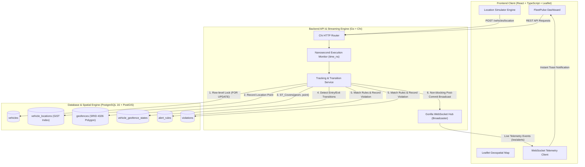

# FleetPulse — Intelligent Geofencing & Real-Time Fleet Tracking

[](https://golang.org)
[](https://www.postgresql.org)
[](https://postgis.net)
[](https://react.dev)
[](https://www.typescriptlang.org)
[](https://vitejs.dev)
[](https://tailwindcss.com)
[](https://www.docker.com)

**FleetPulse** is a production-grade enterprise fleet intelligence and geospatial boundary platform. Engineered from scratch to meet the rigorous performance, architectural, and UI/UX standards of modern fleet logistics operations, FleetPulse delivers real-time vehicle tracking, point-in-polygon geofence enforcement, sub-millisecond transition detection, and instant WebSocket alert delivery.

---

## Architecture Overview



---

## Key Features

1. **Polygon Geofencing Engine**:
   - Create arbitrary polygon boundaries on interactive Leaflet maps with real-time vertex tracking and automatic closure.
   - Categorized enforcement: `delivery_zone`, `restricted_zone`, `toll_zone`, and `customer_area`.
   - PostGIS spatial indexing with `ST_Covers(geom, ST_SetSRID(ST_MakePoint(lon, lat), 4326))` for sub-millisecond evaluation.

2. **Real-Time Point-in-Polygon & Transition State Machine**:
   - `Outside -> Inside` = **ENTRY** transition.
   - `Inside -> Outside` = **EXIT** transition.
   - `Inside -> Inside` = Duplicate suppression (zero false duplicate events).
   - Strict concurrency control using row-level locking (`SELECT ... FOR UPDATE`) per vehicle.

3. **High-Throughput WebSocket Alert System**:
   - Event hub handling concurrent connected clients with ping/pong heartbeats and write deadlines.
   - Asynchronous broadcast execution that never blocks database transactions or client HTTP requests.
   - Rich client-side toast notifications with audio-visual distinction between warnings and critical perimeter breaches.

4. **Interactive Location Simulator**:
   - **Interactive Map Pin Mode**: Click anywhere on the map to immediately transmit real GPS updates to `POST /vehicles/location`.
   - **Automated Route Playback**: Pre-configured realistic route simulations (e.g., Restricted Zone Breach, Market Street Delivery Corridor) with Play, Pause, Reset, and Speed controls (1x, 2x, 5x).
   - Real-time feedback displaying backend-detected geofences and persisted alerts.

5. **Historical Violation Audit Log**:
   - Searchable, filterable audit trail with filters for vehicle, geofence, event type, and date ranges.
   - Formatted local timezone timestamps with UTC persistence.
   - Modal spatial inspector showing exact coordinates and the polygon boundary on an isolated map.

6. **Precision & Compliance**:
   - Every single API response includes `"time_ns": "<execution_time_in_nanoseconds>"` measured natively in Go.
   - Uniform error envelope with semantic HTTP status codes.

---

## Color Palette & Design System

FleetPulse adheres to a sophisticated light-first design system inspired by Linear, Stripe, and Vercel:

| Design Token | Hex Code | Purpose |
|---|---|---|
| **Deep Navy** | `#101B2D` | Brand navigation, sidebars, headers |
| **Midnight** | `#17243A` | Secondary surface accents, borders |
| **Primary Blue** | `#2563EB` | Primary interactive buttons, links, delivery zones |
| **Teal Accent** | `#0F9D8A` | Operational status indicators, customer areas |
| **Surface** | `#FFFFFF` | Main cards, tables, modals |
| **Background** | `#F5F7FA` | Canvas background |
| **Border** | `#E5EAF0` | Structural dividers and cards |
| **Text Main** | `#172033` | Primary typography |
| **Text Muted** | `#667085` | Metadata and secondary labels |
| **Danger / Restricted** | `#DC4C4C` | Restricted zones, entry breach alerts |
| **Warning / Toll** | `#E9A23B` | Toll corridors, exit warnings |
| **Success** | `#16A36A` | Active fleet indicators, health verification |

---

## Quick Start (Docker Compose)

The easiest way to run the complete working platform is using Docker Compose:

```bash
# Clone and enter directory
cd "d:\Coding\Mapup Assignment"

# Start the complete stack
docker compose up --build
```

Access the services:
- **Web Application**: [http://localhost:3000](http://localhost:3000) (or `http://localhost:5173`)
- **Backend API**: [http://localhost:8080](http://localhost:8080)
- **Health Endpoint**: [http://localhost:8080/health](http://localhost:8080/health)

---

## Local Development (Without Docker)

### 1. Database
Ensure PostgreSQL is running with the PostGIS extension:
```sql
CREATE DATABASE fleetpulse;
\c fleetpulse;
CREATE EXTENSION IF NOT EXISTS "uuid-ossp";
CREATE EXTENSION IF NOT EXISTS postgis;
```

Apply migrations:
```bash
psql -U postgres -d fleetpulse -f backend/migrations/000001_init_schema.up.sql
```

Seed demo data:
```bash
cd backend
go run ./cmd/seed
```

### 2. Run Backend
```bash
cd backend
go run ./cmd/server
```

### 3. Run Frontend
```bash
cd frontend
npm install
npm run dev
```

---

## Testing & Quality Assurance

### Run Backend Unit & Integration Tests:
```bash
cd backend
go test -v ./tests/...
```

### Run Backend Race Detector:
```bash
cd backend
go test -race ./tests/...
```

### Run Frontend Vitest Suite:
```bash
cd frontend
npm test
```

### Run Production Frontend Build:
```bash
cd frontend
npm run build
```

---

## End-to-End Demonstration Workflow

Follow these steps to evaluate the end-to-end functionality of FleetPulse:

1. **Launch Dashboard**: Open [http://localhost:5173](http://localhost:5173) (or `http://localhost:3000`).
2. **Navigate to Live Tracking**: Click **Live Tracking** in the sidebar.
3. **Select a Vehicle**: Choose `KA-01-AB-1234` or any vehicle from the dropdown.
4. **Interactive Map Click**:
   - Click **Enable Map Click** in the Location Simulator bar.
   - Click on any area outside the red polygon. Notice the coordinates update with 0 events.
   - Click inside the **Presidio Security Restricted Enclave** (red zone).
   - Observe an immediate **ENTRY** event notification toast, live marker repositioning, and persisted violation record.
   - Click outside the red zone again.
   - Observe an immediate **EXIT** event notification toast.
5. **Automated Route Playback**:
   - In the Location Simulator, select **Restricted Zone Breach** and click **Run Route**.
   - Watch the vehicle traverse the perimeter waypoint-by-waypoint at chosen speed (1x, 2x, 5x).
6. **Verify Audit Trail**:
   - Click **Violation History** in the sidebar.
   - View the persisted records with vehicle number, driver, geofence, and local timestamps.
   - Click the map pin icon on any row to open the spatial inspector modal.
7. **Create a New Geofence**:
   - Click **Geofences** -> **Create New Geofence**.
   - Enter name, select category, and click points on the interactive map to draw a custom polygon.
   - Save and observe the new perimeter rendered on the live map.

---

## Evaluator Acceptance Checklist

- [x] Backend runs in Go with Chi router and pgx connection pooling.
- [x] Database runs on PostgreSQL 16 with PostGIS spatial extension.
- [x] All required API routes implemented with exact paths and HTTP methods.
- [x] Every response includes `"time_ns": "..."` execution benchmark.
- [x] Point-in-polygon containment evaluated using PostGIS `ST_Covers`.
- [x] State machine detects Outside -> Inside (`entry`) and Inside -> Outside (`exit`).
- [x] Real-time Gorilla WebSocket hub broadcasts events to connected clients.
- [x] Frontend features interactive Leaflet maps with custom vehicle markers and category polygon styling.
- [x] Interactive Location Simulator supports both map clicking and automated route execution.
- [x] Violation audit log supports vehicle, geofence, event type, and date range filtering.
- [x] Dockerfile (backend & frontend) and docker-compose.yml are configured for multi-stage production deployment.
- [x] Go unit & integration tests pass with race condition detector (`-race`).
- [x] Comprehensive documentation provided in `README.md` and `SETUP.md`.

